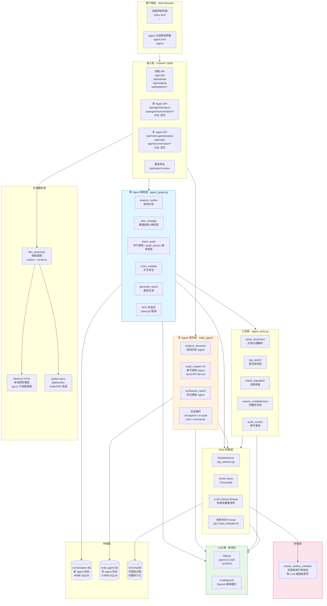
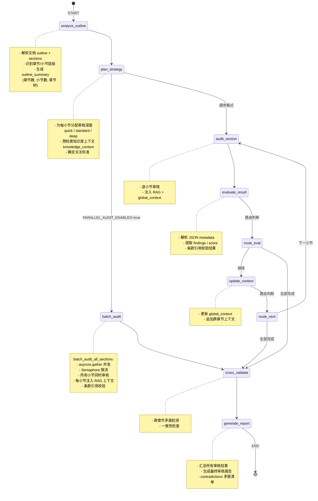
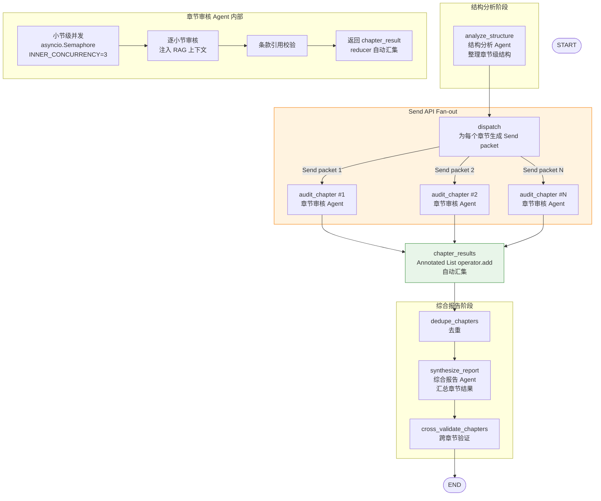
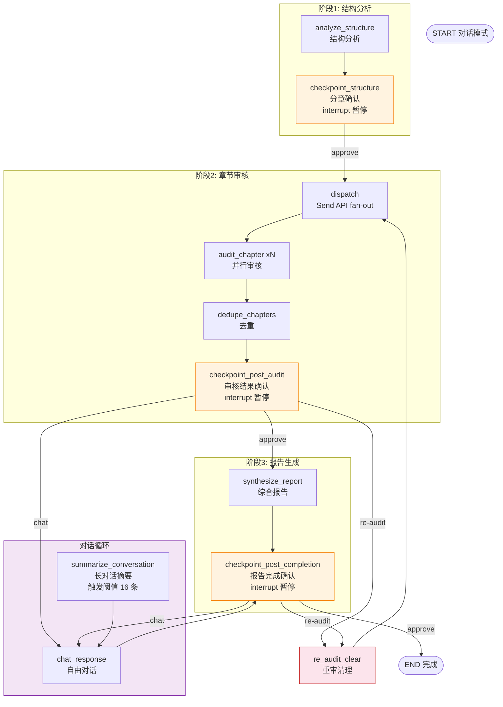
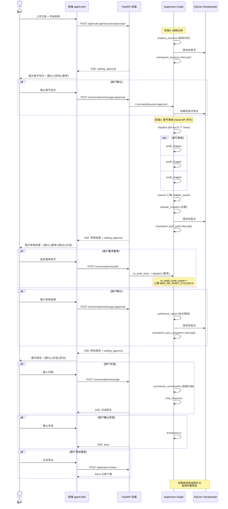
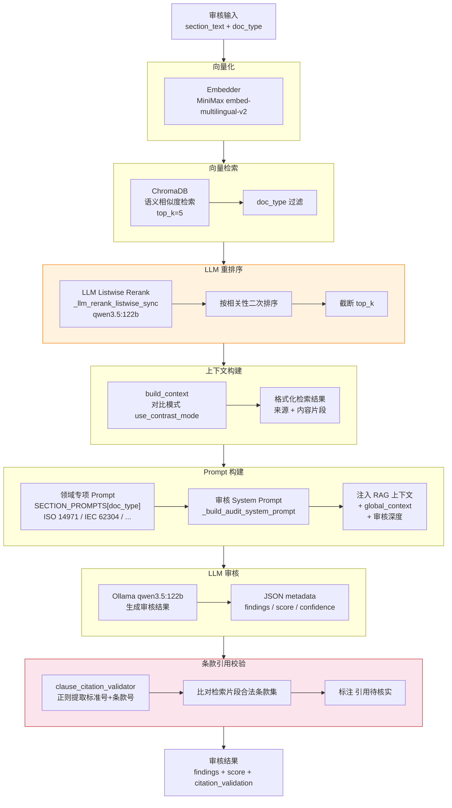
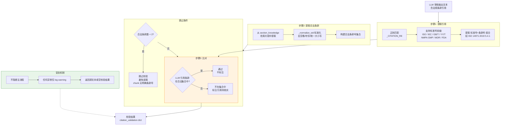
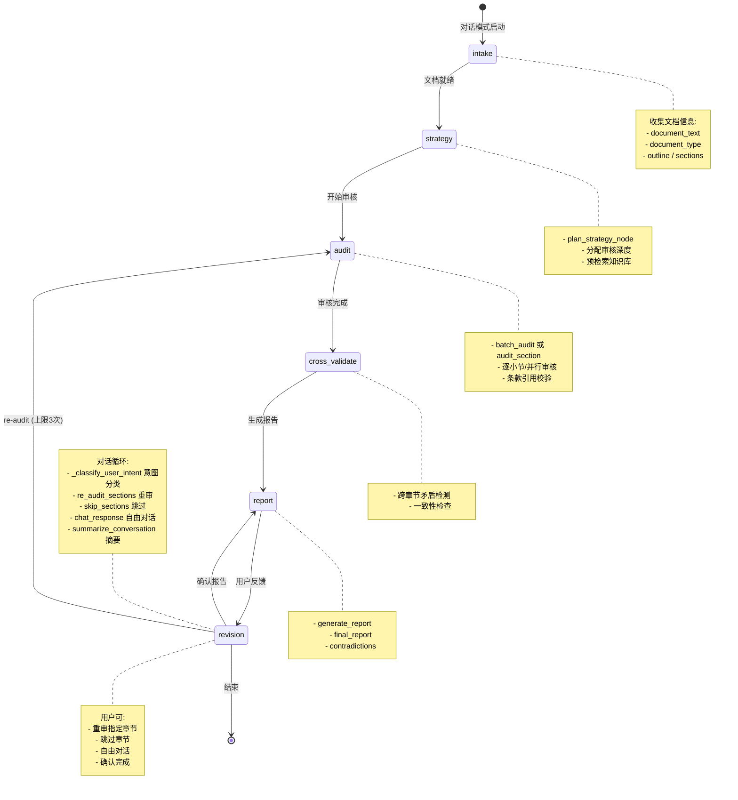
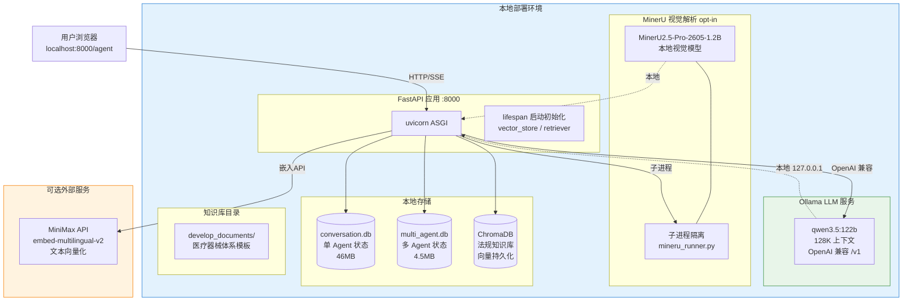
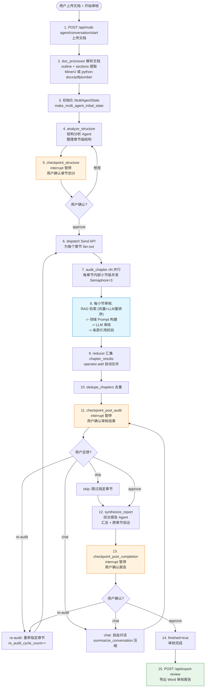

# 医疗器械体系文件审核 Agent v2.0 技术架构图

> 本文档通过多视角 Mermaid 图表，详细描述系统的技术架构、Agent 审核图拓扑、多代理协作、HITL 交互流程、RAG 检索流水线与部署拓扑。

---

## 1. 系统总体架构图（分层视图）

---

## 2. 单 Agent 审核图（并行模式）

---

## 3. 多 Agent 协作图（Supervisor Graph）

---

## 4. 多 Agent 对话模式拓扑（含 HITL 检查点）

---

## 5. HITL 检查点交互时序图

---

## 6. RAG 检索流水线图

---

## 7. 法规条款引用校验流程图

---

## 8. 对话模式状态流转图

---

## 9. 部署架构图

---

## 10. 完整审核数据流图

---

## 11. 图例与说明

| 图表编号 | 名称 | 视角 | 说明 |
|----------|------|------|------|
| 1 | 系统总体架构图 | 分层视图 | 展示客户端、接入层、单Agent/多Agent、工具、RAG、校验、LLM、存储全栈分层 |
| 2 | 单 Agent 审核图 | LangGraph 视角 | 展示并行模式和顺序模式的节点流转与路由判断 |
| 3 | 多 Agent 协作图 | Send API 视角 | 展示 Supervisor Graph 的 fan-out 并行和 reducer 汇集 |
| 4 | 多 Agent 对话模式拓扑 | HITL 视角 | 展示 3 个检查点 + re-audit + chat 循环 |
| 5 | HITL 交互时序图 | 交互视角 | 展示用户确认/重审/对话/导出的完整时序 |
| 6 | RAG 检索流水线图 | 检索视角 | 展示向量检索 + LLM 重排序 + 上下文构建 + 条款校验 |
| 7 | 法规条款引用校验流程 | 校验视角 | 展示正则提取 + 比对 + 跳过条件 + 安全机制 |
| 8 | 对话模式状态流转图 | 状态视角 | 展示 intake -> strategy -> audit -> report -> revision 流程 |
| 9 | 部署架构图 | 部署视角 | 展示本地服务、端口、存储和可选外部服务 |
| 10 | 完整审核数据流图 | 端到端视角 | 展示从文档上传到报告导出的完整流转 |

> **渲染说明**：以上 Mermaid 图表可在 GitHub、VS Code（Mermaid 插件）、Typora、Notion 等支持 Mermaid 的编辑器中直接渲染。也可使用 [mermaid.live](https://mermaid.live) 在线预览。
